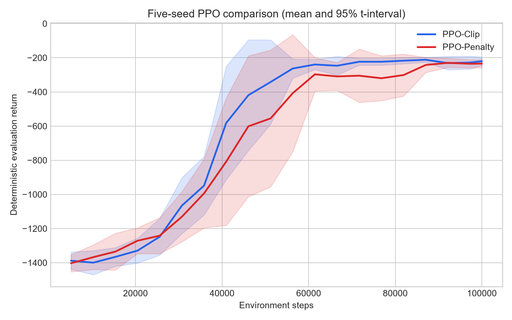
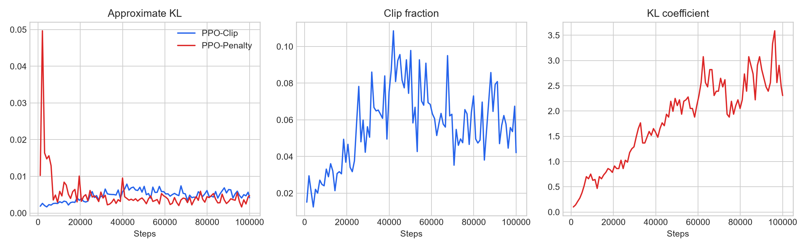
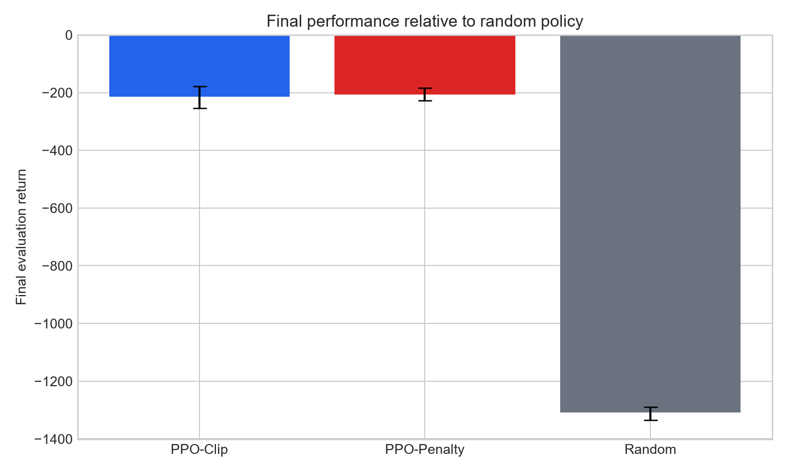

# PPO from Scratch: Five-Seed Clip and KL-Penalty Comparison

> PyTorch implementation and matched-seed experiment  
> Experiment date: 2026-11-11  
> Environment: Pendulum-v1

## Abstract

This project implements PPO-Clip and adaptive KL-Penalty PPO in PyTorch without a ready-made RL algorithm. On Pendulum-v1, each method was trained for 100,000 environment steps with 5 matched seeds. The final policies were evaluated deterministically on 20 separately seeded episodes per run, alongside a random-policy baseline.

Mean final returns were -213.52 for PPO-Clip and -206.06 for PPO-Penalty, compared with -1308.50 for the random policy. PPO-Clip achieved the higher mean learning-curve AUC. The paired final-return difference was -7.46, with a 95% bootstrap interval of [-45.99, 27.99]; the final-return ranking remains unresolved in this experiment.

## 1. Implementation

- Separate actor and critic MLPs with independent gradient clipping.
- Categorical policies and tanh-squashed Gaussian policies with tanh and affine Jacobian corrections.
- Generalized Advantage Estimation with distinct true-termination and time-limit-truncation handling.
- Running observation normalization persisted with each trained policy.
- PPO-Clip and adaptive KL-Penalty updates, configurable learning-rate scheduling, raw-reward logging, and optional reward scaling during training.
- CSV/TensorBoard logging, saved final model weights, fixed-seed evaluation, matched-seed aggregation, bootstrap intervals, and a random-policy baseline.

## 2. Protocol

| Parameter                            | Value                              |
| ------------------------------------ | ---------------------------------- |
| Training seeds                       | 0, 1, 2, 3, 4                      |
| Environment steps per run            | 100,000                            |
| Rollout / mini-batch                 | 1024 / 64                          |
| PPO epochs                           | 10                                 |
| Learning rate                        | 0.0003                             |
| Gamma / GAE lambda                   | 0.99 / 0.95                        |
| Observation normalization            | True                               |
| Reward scale for training targets    | 0.1                                |
| Final evaluation                     | 20 deterministic episodes per seed |
| PPO-Penalty target KL / initial beta | 0.003 / 0.1                        |

The configurations saved with each run match those in `configs/`. Periodic evaluations reuse episode seeds within each run; final evaluations use a separate fixed seed range. Each run saves its final model weights in `model.pt`.

## 3. Results

### 3.1 Main comparison

| Method      | Seeds | Final Return | Across-Seed SD | 95% CI Low | 95% CI High | Learning-Curve AUC |
| ----------- | ----- | ------------ | -------------- | ---------- | ----------- | ------------------ |
| PPO-Clip    | 5     | -213.52      | 51.20          | -254.82    | -177.44     | -619.71            |
| PPO-Penalty | 5     | -206.06      | 27.85          | -228.29    | -183.69     | -683.27            |





The KL lines use different summaries: PPO-Clip averages estimates across update mini-batches, while PPO-Penalty reports a post-update estimate over the full rollout.

### 3.2 Per-seed results

| Method      | Seed | Final Return | Last 3 Evaluations | Curve AUC |
| ----------- | ---- | ------------ | ------------------ | --------- |
| PPO-Clip    | 0    | -293.31      | -270.92            | -573.87   |
| PPO-Clip    | 1    | -168.41      | -216.19            | -630.43   |
| PPO-Clip    | 2    | -211.73      | -223.03            | -717.45   |
| PPO-Clip    | 3    | -224.83      | -225.25            | -630.12   |
| PPO-Clip    | 4    | -169.32      | -197.20            | -546.69   |
| PPO-Penalty | 0    | -215.91      | -236.26            | -597.90   |
| PPO-Penalty | 1    | -167.35      | -240.35            | -639.99   |
| PPO-Penalty | 2    | -243.35      | -257.17            | -829.50   |
| PPO-Penalty | 3    | -195.48      | -227.80            | -741.18   |
| PPO-Penalty | 4    | -208.19      | -203.42            | -607.78   |

### 3.3 Random-policy baseline

| Baseline | Seeds | Final Return | Across-Seed SD |
| -------- | ----- | ------------ | -------------- |
| Random   | 5     | -1308.50     | 29.66          |



## 4. Statistical interpretation

Across the five matched seeds, the mean final-return difference (PPO-Clip minus PPO-Penalty) was -7.46. A 20,000-resample paired bootstrap gives a 95% interval of [-45.99, 27.99]. Because it spans zero, the final-return data do not establish an advantage for either method.

PPO-Clip had the higher learning-curve AUC in all five matched seeds. AUC is the step-normalized trapezoidal area of periodic evaluation returns from the first evaluation point through 100,000 steps. The last-three-evaluation mean describes late-training performance; the final-return measure uses a separate set of episode seeds.

## 5. Correctness and result traceability

Automated tests cover numerical GAE behavior, truncation bootstrapping, rollout shapes, action bounds, transformed log probabilities, observation-normalizer persistence, discrete-policy interfaces, a sampled KL estimate, and a finite PPO update that changes policy parameters.

```powershell
python -m pytest -q
python scripts/run_experiments.py
python scripts/run_random_baseline.py
python scripts/analyze_results.py
python scripts/generate_report.py
```

Runtime metadata for this experiment: Python 3.11.1, PyTorch 2.15.0+cpu, Gymnasium 1.4.0, NumPy 2.4.6, Windows-10-10.0.26200-SP0.

## 6. Limitations

- Results describe Pendulum-v1 under the reported 100,000-step protocol and PPO-Penalty configuration (target KL 0.003, initial beta 0.1).
- Five training seeds leave small between-method final-return differences uncertain.

## 7. Deliverables

- Core implementation: `models/`, `algorithms/`, `utils/`
- Experiment entry points: `scripts/`
- Experiment configurations: `configs/`
- Tests: `tests/`
- Seed-level logs and final model weights: `results/logs/validated_main/`
- Random-policy baseline: `results/reference/random/`
- Tables and figures: `results/tables/`, `results/figures/`
