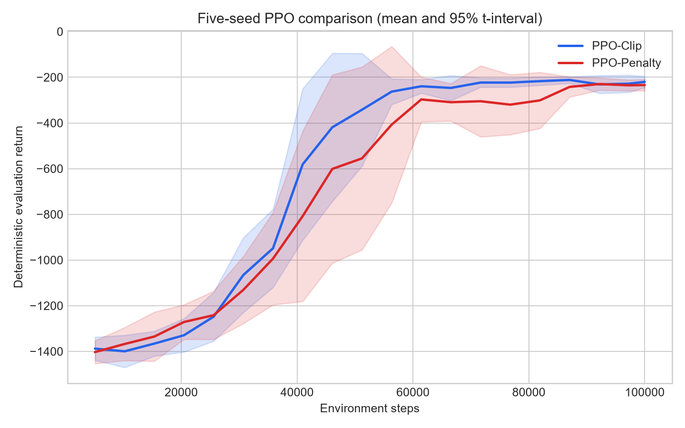
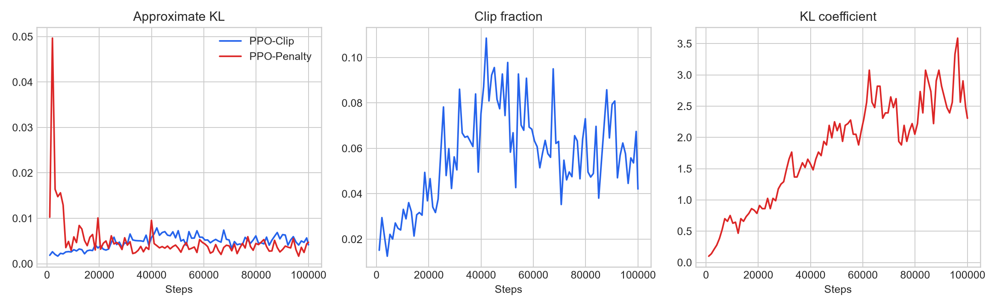
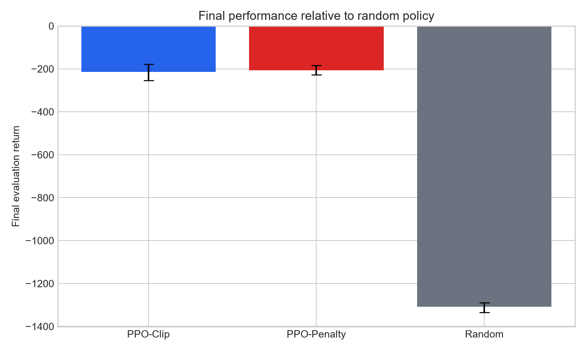

# PPO from Scratch

A PyTorch implementation of PPO-Clip and adaptive KL-Penalty PPO without using a ready-made RL algorithm, evaluated in a five-seed comparison on `Pendulum-v1`.

## Experiment results

The comparison uses five matched training seeds, 100,000 environment steps per run, the same evaluation episode seeds at each periodic evaluation within a run, and 20 separately seeded deterministic evaluation episodes for each final policy.

| Method | Mean final return | Across-seed SD | Learning-curve AUC |
| --- | ---: | ---: | ---: |
| PPO-Clip | -213.52 | 51.20 | -619.71 |
| PPO-Penalty | -206.06 | 27.85 | -683.27 |
| Random policy | -1308.50 | 29.66 | N/A |

The matched-seed final-return difference, PPO-Clip minus PPO-Penalty, is `-7.46` with a paired bootstrap 95% interval of `[-45.99, 27.99]`. The interval crosses zero, so this experiment does not support a directional final-performance claim. In these five runs, PPO-Clip has the higher learning-curve AUC and PPO-Penalty has the lower across-seed final-return standard deviation. AUC is the trapezoidal average of periodic evaluation returns from the first evaluation point to 100,000 steps.

At 100,000 steps, all ten final policies outperform the evaluated random-policy baseline; the results establish performance on this single environment, not general superiority of either PPO variant.







## Implemented components

- Separate actor and critic MLPs with independent gradient clipping
- Categorical policies for discrete actions
- Tanh-squashed Gaussian policies for bounded continuous actions
- Tanh and affine Jacobian corrections in transformed log probabilities
- On-policy rollout buffer and Generalized Advantage Estimation
- Correct distinction between true termination and time-limit truncation
- Running observation normalization saved with each trained policy
- Optional reward scaling during training and configurable learning-rate scheduling
- PPO clipped surrogate objective
- KL-penalized PPO with adaptive beta and a post-update sampled KL estimate over the full rollout
- CSV and TensorBoard logs, saved final model weights, fixed-seed evaluation, matched-seed aggregation, bootstrap intervals, figures, and report generation

## Setup

```powershell
py -3.11 -m venv .venv
.\.venv\Scripts\python -m pip install -r requirements.txt
```

## Tests

```powershell
.\.venv\Scripts\python -m pytest -q
```

The eight automated tests cover hand-calculated GAE, truncation bootstrapping, rollout shapes, transformed policy probabilities, continuous-action bounds, observation-normalizer persistence, discrete-policy interfaces, a full-rollout sampled KL estimate, and a finite PPO update that changes policy parameters.

## Run the five-seed experiment

```powershell
.\.venv\Scripts\python scripts\run_experiments.py
.\.venv\Scripts\python scripts\run_random_baseline.py
.\.venv\Scripts\python scripts\analyze_results.py
.\.venv\Scripts\python scripts\generate_report.py
.\.venv\Scripts\python scripts\record_policy.py `
  --run-dir results\logs\validated_main\ppo_clip\seed_1
```

Completed runs containing `summary.json` are skipped. An interrupted batch can continue with remaining runs; an interrupted individual run restarts from the beginning. The runner does not check whether existing results match changed configurations, so use `--force` after changing a configuration.

## Train or evaluate one policy

```powershell
.\.venv\Scripts\python scripts\train.py `
  --config configs\ppo_clip.yaml `
  --seed 0 `
  --output-dir results\logs\manual_clip_seed0

.\.venv\Scripts\python scripts\evaluate.py `
  --run-dir results\logs\manual_clip_seed0 `
  --episodes 20
```

## Project structure

```text
algorithms/    PPO-Clip and adaptive KL-Penalty updates
configs/       Configurations used for the reported experiment
environments/  Gymnasium environment construction
models/        Discrete and continuous actor-critic networks
scripts/       Training, evaluation, baselines, analysis, and reporting
tests/         Numerical, interface, and update tests
utils/         Buffer, GAE, normalization, evaluation, and training utilities
results/       Raw runs, random baseline, tables, figures, and media
```

See [EXPERIMENT_REPORT.md](EXPERIMENT_REPORT.md) for the complete protocol, seed-level results, statistical interpretation, and limitations.

## References

- [Schulman et al., Proximal Policy Optimization Algorithms (2017)](https://arxiv.org/abs/1707.06347) — PPO-Clip and KL-Penalty objectives.
- [Schulman et al., High-Dimensional Continuous Control Using Generalized Advantage Estimation (2015)](https://arxiv.org/abs/1506.02438) — GAE.

These papers define the methods implemented here; the experiment settings and results above are specific to this repository.
